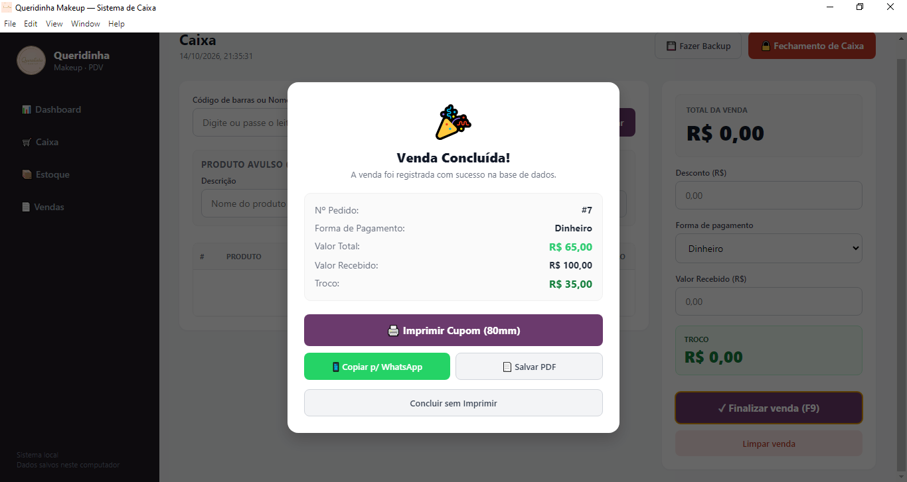

# 💄 Queridinha Makeup — Sistema de Caixa & PDV Desktop

O **Queridinha Makeup PDV** é um sistema de caixa e gestão de estoque desktop desenvolvido sob medida para lojas de cosméticos e comércio varejista. A aplicação funciona de forma 100% local e offline, oferecendo controle de estoque, leitura de código de barras (EAN), fechamento de caixa, impressão de cupons térmicos (80mm) e painel analítico com indicadores de vendas.

---

## 📸 Demonstração do Sistema


*Interface de caixa com busca rápida por código EAN, produtos avulsos e cálculo automático de troco.*


*Painel analítico com faturamento, lucro bruto, ticket médio e análise da Curva ABC.*


*Histórico de vendas com detalhamento expansível de itens, reimpressão de cupons e cancelamento com estorno ao estoque.*


*Controle de estoque com edição rápida, busca dinâmica e importação em massa de planilhas Excel/CSV.*

---

## ✨ Funcionalidades Principais

### 🛒 Ponto de Venda (PDV / Caixa)
- **Busca Agilizada**: Leitura e busca rápida por Código de Barras (EAN) ou nome do produto.
- **Produtos Avulsos**: Suporte a inclusão de itens fora do estoque (sacolas, itens promocionais avulsos).
- **Descontos & Troco**: Aplicação de descontos no valor total e cálculo automático de troco.
- **Múltiplos Pagamentos**: Dinheiro, PIX, Cartão de Crédito e Débito.
- **Atalho Rápido**: Tecla `F9` para finalização instantânea de venda.

### 🖨️ Impressão de Cupons e Relatórios
- **Impressão Térmica**: Emissão de comprovante de venda não fiscal otimizado para impressoras térmicas de 80mm.
- **Fechamento de Caixa**: Relatório impresso de consolidação de faturamento segregado por método de pagamento.
- **Gestão do Histórico**: Reimpressão de cupons antigos e cancelamento de vendas com estorno automático de itens ao estoque.

### 📊 Dashboard Analítico
- **Visão Financeira**: Faturamento Total e Lucro Bruto estimado.
- **Indicadores Operacionais**: Ticket Médio e UPT (Unidades por Transação / Itens por Nota).
- **Análise de Curva ABC**: Classificação automática em Classe A (80% do faturamento), Classe B (15%) e Classe C (5%).
- **Ranking**: Destaque dos TOP 3 Produtos Mais Vendidos.
- **Filtros Temporais**: Hoje, Últimos 7 dias, Este Mês ou Todo o Histórico.

### 📦 Gestão de Estoque
- **Consulta Dinâmica**: Filtragem por Nome, Categoria ou Código EAN.
- **Importação Massiva**: Leitura de planilhas Excel (`.xlsx`, `.xls`, `.xlsm`) e CSV para atualização em lote.
- **Edição Rápida**: Correção direta de preços, estoque e códigos de barras.

---

## 💾 Segurança dos Dados

- **Backup da Base**: Exportação em 1 clique do banco de dados SQLite (`caixa.db`).
- **Persistência Segura**: Armazenamento nativo na pasta de dados do usuário (`AppData`), garantindo permissões de leitura/escrita no Windows sem risco de perda em atualizações.

---

## 🛠️ Tecnologias Utilizadas

- **Electron.js** — Framework para desenvolvimento de aplicações desktop cross-platform.
- **Node.js** — Ambiente de execução JavaScript.
- **SQLite3** — Banco de dados relacional leve e embutido.
- **SheetJS (XLSX)** — Processamento e importação de arquivos de planilha (CSV/XLSX).
- **HTML5 / CSS3 / JavaScript (ES6+)** — Interface do usuário responsiva e customizada.
- **Electron Builder** — Empacotamento e compilação do executável instalador (`.exe`).

---

## 🚀 Como Executar o Projeto Localmente

### Pré-requisitos
- [Node.js](https://nodejs.org/) (versão 18 ou superior)
- [Git](https://git-scm.com/)

### Passo a Passo

1. **Clonar o repositório:**
   ```bash
   git clone [https://github.com/stroomper/sistema-pdv-queridinha-makeup.git](https://github.com/stroomper/sistema-pdv-queridinha-makeup.git)
   cd sistema-pdv-queridinha-makeup
2. Instalar as dependências:

Bash
npm install
Recompilar módulos nativos (SQLite3):

Bash
npx electron-builder install-app-deps
Executar a aplicação em modo de desenvolvimento:

Bash
npm start

3.📦 Como Gerar o Executável (.exe)
Para compilar o instalador da aplicação para Windows:

Bash
npm run dist
O arquivo de instalação gerado estará disponível dentro do diretório dist/ (ex: dist/Queridinha Makeup PDV Setup 1.0.0.exe).

📄 Licença
Este projeto é de uso privado para a loja Queridinha Makeup e está sob a licença ISC.


---
